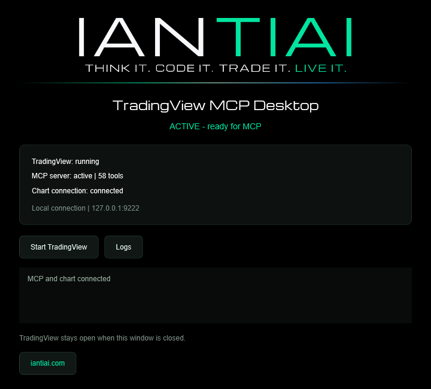
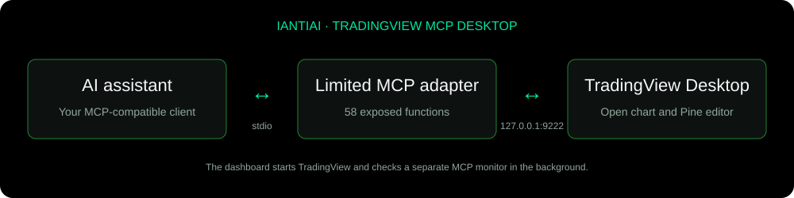

# IANTIAI TradingView MCP Desktop

**Connect your AI assistant to TradingView Desktop. Read chart data. Develop Pine Script indicators.**

A compact Windows dashboard that starts TradingView Desktop with a local connection and checks the limited MCP bridge in the background. The interface uses IANTIAI branding, an English UI, and a console-free launcher.

[Website](https://iantiai.com/) · [All 58 MCP tools](docs/TOOLS.md) · [User guide](docs/GUIDE.md)





*Dashboard illustration rendered from the application's actual WPF layout, showing a representative connected state. Connection status in the running application is determined by live checks.*

## What you can do

- Read OHLCV candles, current study values and indicator settings from the open chart.
- Inspect Pine-drawn lines, labels, tables and boxes.
- Switch symbols, timeframes and chart types; inspect and adjust the visible range.
- Read, create, edit, analyze, compile and privately save Pine Script indicators.
- Add indicators, change inputs and toggle visibility.
- Capture the chart and work with tabs and layouts.
- Read Strategy Tester performance, simulated trade lists and equity curves.
- Read and edit watchlists; arrange multiple chart panes and choose their symbols.
- Read current quotes and available depth-of-market data.

The current adapter exposes **58 MCP tools**. A tool is a callable function available to a connected AI assistant, not an additional installed program. The dashboard is a launcher and monitor; it is not a chat application or an AI model.

## Requirements

- Windows with Windows PowerShell 5.1 and WPF.
- TradingView Desktop installed for the current user, with a chart open.
- Node.js with npm, and Git available on `PATH`.
- An MCP-compatible AI client to use the tools. The dashboard can run without one, but does not issue development prompts itself.
- An internet connection for initial setup and normal TradingView operations. Existing TradingView subscriptions and data permissions still apply.

## Install and start

1. Download this repository using **Code → Download ZIP** and extract it, or clone it with Git.
2. Open PowerShell in the extracted repository folder and run:

   ```powershell
   powershell.exe -NoProfile -ExecutionPolicy Bypass -File .\scripts\setup.ps1
   ```

   Setup downloads [tradesdontlie/tradingview-mcp](https://github.com/tradesdontlie/tradingview-mcp) at the pinned commit `c05b8f5755ed8e64ea242de88ddbf46aa24d56a4`, installs its locked dependencies with `npm ci --ignore-scripts`, and performs an offline MCP smoke test.

3. Double-click **START_IANTIAI_TRADINGVIEW.vbs**. The dashboard starts TradingView and its MCP monitor without a separate console window.
4. Wait for **ACTIVE - ready for MCP** and **Chart connection: connected**.
5. Configure your AI client's MCP server using the example below.

If TradingView was already open without the local connection, save your work and close it normally. The starter waits for it to close and then relaunches it. No TradingView process is force-closed.

## Connect an AI client

The bridge uses the MCP **stdio** transport. Configure your client's equivalent of `mcpServers`:

```json
{
  "mcpServers": {
    "iantiai-tradingview-desktop": {
      "command": "node",
      "args": ["C:/path/to/iantiai-tradingview-mcp-desktop/mcp-server.mjs"]
    }
  }
}
```

Replace the example path with your absolute repository path. Your AI client starts its own MCP server process; the dashboard's monitoring process does not replace that configuration.

## Example prompts

> Read the current chart's symbol, timeframe and last 100 OHLCV candles. Summarize the range and volume without changing the chart.

> Read the current indicator values and Pine tables. Tell me which values are available and which are missing.

> Back up the current Pine editor source. Create a simple EMA indicator, compile it, read the compiler errors, and explain the result. Ask before replacing any unsaved script.

> Inspect this indicator's inputs and plotted values, then compare its calculation with the expected formula on several bars.

See the [guide](docs/GUIDE.md) for a full development workflow and troubleshooting, and the [tool reference](docs/TOOLS.md) for every function.

## Connection and operating limits

The TradingView connection is fixed to **127.0.0.1:9222**. The starter verifies that the listener belongs to TradingView and is restricted to loopback. Do not expose this port to the network: local Chrome DevTools Protocol access can control the signed-in application.

The limited adapter excludes trade execution, broker control, alerts, replay, arbitrary JavaScript evaluation, generic clicking/typing, forced restarts and automatic updates. Compilation and saving communicate with TradingView through the signed-in session. Preserve existing editor contents before writing or creating scripts.

An active connection and a successful compile do not establish that an indicator's calculations are correct. Verify values, timezones, sessions, bar history and repainting behavior independently.

This application is not affiliated with or endorsed by TradingView. TradingView software, accounts and market data are not included. Internal TradingView interfaces can change and break compatibility.

## Verification

```powershell
node .\mcp-check.mjs             # Handshake, allowlist and offline Pine analysis
node .\mcp-check.mjs --live      # Adds read-only checks of the open chart
node .\scripts\export-tools.mjs # Regenerates tool reference and parameter schemas
```

For this initial packaging, the adapter handshake, 58-tool catalogue, allowlist and offline Pine analysis were checked against the existing pinned local runtime. The dashboard layout and PowerShell syntax were checked. A fresh installation on another PC and every individual live tool have not been tested.

## Credits

Created for [IANTIAI](https://iantiai.com/). The MCP functionality is built on [tradesdontlie/tradingview-mcp](https://github.com/tradesdontlie/tradingview-mcp), distributed under its [MIT license and additional notice](THIRD_PARTY_LICENSE.txt). The setup downloads upstream separately; this repository supplies the limited adapter, dashboard and documentation.

Michroma is bundled under the [SIL Open Font License](app/assets/Michroma-OFL.txt). IANTIAI logos and branding remain IANTIAI assets. No separate open-source license for the IANTIAI application code has been assigned in this initial package.


