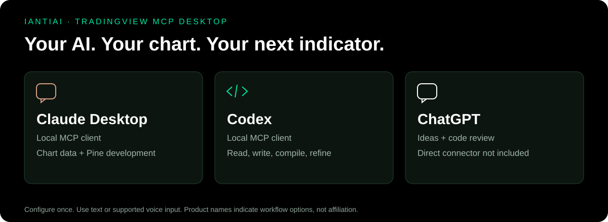
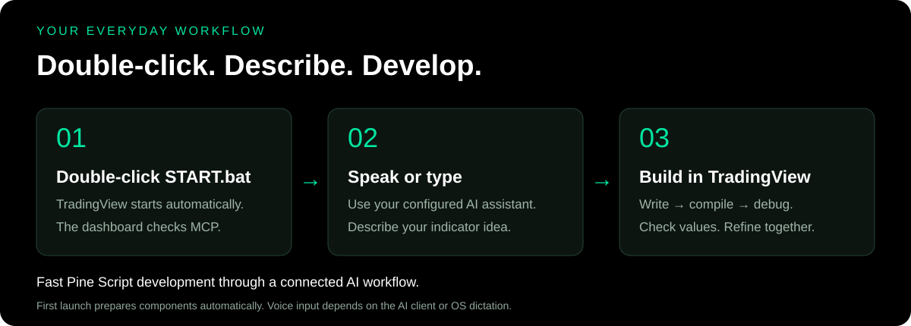

# IANTIAI TradingView MCP Desktop

**Your voice. Your AI. Your TradingView.**

**[Download the Windows user package](https://github.com/IANTIAI/iantiai-tradingview-mcp-desktop/releases/download/v1.2.1/IANTIAI-TradingView-MCP-Desktop.zip)** — extract it and double-click **START.bat**.

Double-click to start the dashboard and TradingView automatically. Use Claude Desktop or the Codex desktop app with MCP to read charts and develop Pine Script indicators through natural-language prompts — including voice input or dictation where your client supports it.

**Describe your idea. Let your AI write, compile, debug and refine your indicator directly in TradingView.** Keep the editor, compiler feedback and chart in one connected workflow to iterate quickly.

A compact Windows dashboard that starts TradingView Desktop with a local connection and checks the limited MCP bridge in the background. The interface uses IANTIAI branding, an English UI, and a console-free launcher.

[Website](https://iantiai.com/) · [All 58 MCP tools](_internal/docs/TOOLS.md) · [User guide](_internal/docs/GUIDE.md)

## Your everyday workflow

**One Click. Easy Use.**

1. **Double-click START.bat.** TradingView and the dashboard start automatically.
2. **Open your configured AI assistant.** Use Claude Desktop or the Codex desktop app with the local MCP connection.
3. **Speak or type your request.** Read chart data, develop an indicator, compile it, review errors and refine the result.

Voice is provided by your AI client's supported input mode or operating-system dictation, not by this dashboard. A separate shell is unnecessary for everyday use.

## Choose your AI assistant

| Assistant | How it fits this package |
| --- | --- |
| Claude Desktop | Start automatically adds the local MCP connection when Claude Desktop is detected. Restart Claude after the first setup. |
| Codex desktop app | Start automatically adds the local MCP connection when the Codex profile is detected. Restart Codex after the first setup. |
| ChatGPT | Useful for discussing indicator ideas and reviewing code. This package does not include a direct ChatGPT connector; ChatGPT app integrations require a separate supported MCP connection. |

Product names identify the clients; the illustrations are original explanatory graphics, not screenshots of those products or an endorsement.

*Dashboard illustration rendered from the application's actual WPF layout, showing a representative connected state. Connection status in the running application is determined by live checks.*

## What you can do

- Read OHLCV candles, current study values and indicator settings from the open chart.
- Inspect Pine-drawn lines, labels, tables and boxes.
- Switch symbols, timeframes and chart types; inspect and adjust the visible range.
- Read, create, edit, analyze, compile and privately save Pine Script indicators.
- Add indicators, change inputs and toggle visibility.
- Capture the chart and work with tabs and layouts.
- Read Strategy Tester performance, simulated trade lists and equity curves.
- Read and edit watchlists; arrange multiple chart panes and choose their symbols.
- Read current quotes and available depth-of-market data.

The current adapter exposes **58 MCP tools**. A tool is a callable function available to a connected AI assistant, not an additional installed program. The dashboard is a launcher and monitor; it is not a chat application or an AI model.

## Start

Open **START_HERE.html** for the short user guide. The only launcher is **START.bat**; all supporting files are in **_internal**.

1. Download the **Windows user package** above and extract the folder.
2. **Double-click START.bat.**
3. TradingView and the dashboard open automatically. Speak or type in your AI assistant.

**One Click. Easy Use.** On the first launch, the branded dashboard automatically prepares missing components and the local MCP connection. You do not need Git, manual PowerShell commands or a separate shell. Subsequent launches open the dashboard directly.

Start reuses a compatible Node.js installation or downloads a verified portable runtime into the application folder. Missing TradingView Desktop is installed through Windows App Installer. Installed Claude Desktop and Codex profiles receive the MCP entry automatically; existing entries and other settings are preserved, with backups before changes.

Internet access is required for the first setup. Windows may show an installer approval prompt. Your TradingView and AI accounts still require your own sign-in, and an AI client that was open during setup must be restarted once. If an AI client is installed later, see the [advanced guide](_internal/docs/ADVANCED.md).

If TradingView was already open without the local connection, save your work and close it normally. The starter waits for it to close and then relaunches it. No TradingView process is force-closed.

## Example prompts

> Read the current chart's symbol, timeframe and last 100 OHLCV candles. Summarize the range and volume without changing the chart.

> Read the current indicator values and Pine tables. Tell me which values are available and which are missing.

> Back up the current Pine editor source. Create a simple EMA indicator, compile it, read the compiler errors, and explain the result. Ask before replacing any unsaved script.

> Inspect this indicator's inputs and plotted values, then compare its calculation with the expected formula on several bars.

> Develop a Pine Script indicator from this idea. Back up the current source, compile the new version, explain any errors, and refine it with me.

See the [guide](_internal/docs/GUIDE.md) for a full development workflow and troubleshooting, and the [tool reference](_internal/docs/TOOLS.md) for every function.

## Connection and operating limits

The TradingView connection is fixed to **127.0.0.1:9222**. The starter verifies that the listener belongs to TradingView and is restricted to loopback. Do not expose this port to the network: local Chrome DevTools Protocol access can control the signed-in application.

The limited adapter excludes trade execution, broker control, alerts, replay, arbitrary JavaScript evaluation, generic clicking/typing, forced restarts and automatic updates. Compilation and saving communicate with TradingView through the signed-in session. Preserve existing editor contents before writing or creating scripts.

An active connection and a successful compile do not establish that an indicator's calculations are correct. Verify values, timezones, sessions, bar history and repainting behavior independently.

This application is not affiliated with or endorsed by TradingView. TradingView software, accounts and market data are not included. Internal TradingView interfaces can change and break compatibility.

## Technical details

Optional configuration and development checks are in the [advanced guide](_internal/docs/ADVANCED.md). They are not part of normal startup.

## Credits

Client setup references: [Claude Desktop local MCP](https://support.claude.com/en/articles/10949351-getting-started-with-local-mcp-servers-on-claude-desktop), [Codex MCP configuration](https://developers.openai.com/codex/mcp/), and [ChatGPT MCP app integration](https://developers.openai.com/plugins/build/app-quickstart).

Created for [IANTIAI](https://iantiai.com/). The MCP functionality is built on [tradesdontlie/tradingview-mcp](https://github.com/tradesdontlie/tradingview-mcp), distributed under its [MIT license and additional notice](_internal/THIRD_PARTY_LICENSE.txt). The setup downloads upstream separately; this repository supplies the limited adapter, dashboard and documentation.

Michroma is bundled under the [SIL Open Font License](_internal/app/assets/Michroma-OFL.txt). IANTIAI logos and branding remain IANTIAI assets. No separate open-source license for the IANTIAI application code has been assigned in this initial package.
